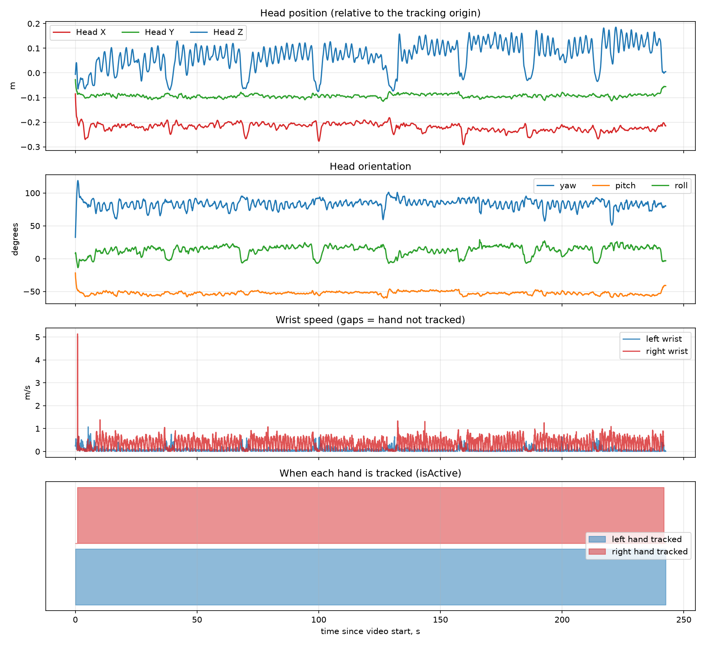
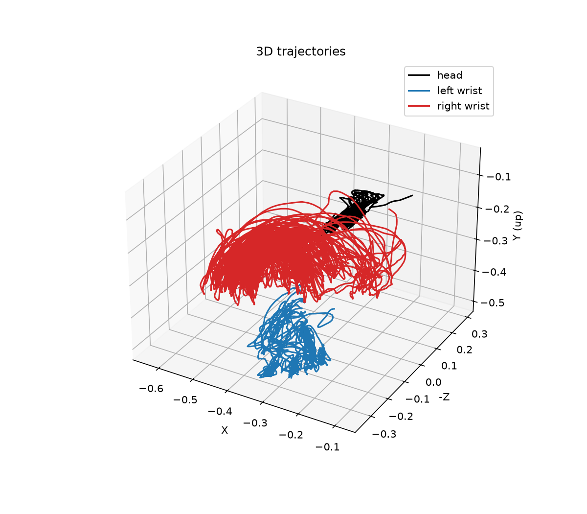
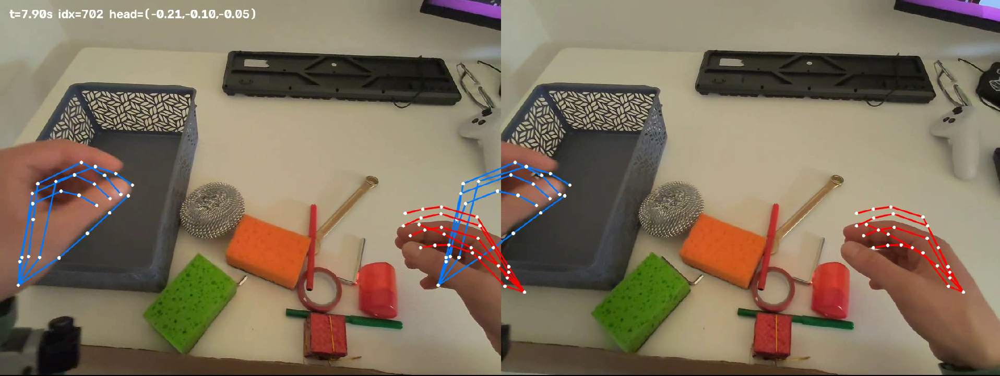

# XR tracking visualization

Visualization of VR headset tracking data (XR-Robotics / PICO) recorded together with a
first-person stereo video: plots and statistics, a synchronized "video + tracking" view, and an
approximate projection of the tracked hands onto the video.

## Example results







Video demo: https://drive.google.com/file/d/162ZdEljvVvTefvWlVg5OzngTclCh20uV/view?usp=sharing

## Data

Not included in the repository (too large). Put these files next to the scripts, or pass paths with
`--track` / `--video`:

- `trackingData_20260505_165740.txt` – JSON Lines, ~90 samples/s
- `CameraRecord_20260505_165740.mp4` – side-by-side stereo video, 2160x810 (two 1080x810 eyes), 30 fps

## Install

```
pip install -r requirements.txt
```

## Usage

| Command | Output |
|---|---|
| `python analyze.py` | `results/overview.png` (head position/orientation, wrist speed, when each hand is tracked), `results/trajectory3d.png`, statistics in the console |
| `python render.py` | `results/side_by_side.mp4` – the video with a top/side view of head, hands and fingers underneath |
| `python overlay.py --t 9` | **one frame**: `results/overlay_9.0s.png` |
| `python overlay.py` | **video**: `results/overlay.mp4` with hand skeletons projected onto the frames (`--start 5 --dur 20` for a clip, `--labels` prints coordinates from the log on the frame) |

## Files

- `xrparse.py` – parser for the tracking log, used by all scripts
- `analyze.py` – static plots and statistics
- `render.py` – video + schematic tracking view
- `overlay.py` – approximate projection of tracked hands onto the video

## Approach

**Parsing.** Numbers in the log use a decimal comma *and* a comma as the list separator, so
`"-0,085,-0,027,..."` is 7 numbers (`x, y, z, qx, qy, qz, qw`) written as 14 tokens; the parser joins tokens in pairs.
A hand with `isActive = 0` keeps stale coordinates in the log, so its joints are replaced with NaN:
such a hand is not drawn, not counted in speed/trajectory statistics, and shows up as a gap in the
"tracked" timeline.

**Synchronization.** `timeStampNs` is Unix time in nanoseconds. The header line holds the timestamp of the first
video frame, so video frame `k` corresponds to `t0 + k/30` s; the nearest tracking sample is used.

**Projection (`overlay.py`).** world joint -> head frame (`Head.pose`) -> camera frame (`cameraExtrinsics`)
-> pixels (`cameraIntrinsics`, pinhole model). Assumptions:

- Tracking uses OpenXR axes: x right, y up, -z forward, metres.
- Extrinsics are given in device axes (x up, y left, z back), so a fixed axis permutation is applied.
- Intrinsics are `[cx, cy, fx, fy]` for an unsqueezed 2160x810 image. Each eye in the video is squeezed
  horizontally by 2, so `fx_video = fx/2 ≈ fy` (square pixels, which supports this reading) and `cx_video = cx/2`.
- Hand joint order is the OpenXR 26-joint layout (wrist = index 1).
- No lens distortion model.

## Observations

- Tracking runs at ~90 Hz, the video at 30 fps.
- Hands are not tracked all the time (a hand leaves the headset cameras' view): see the coverage panel in
  `overview.png` and the statistics printed by `analyze.py`.
- "left hand tracked 100% of the time, right hand 99%"._

## Known problems

- **The overlay is only approximate: hand skeletons are systematically shifted from the real hands.**
  The layout and finger directions look right, but on the checked frame the skeletons are displaced by roughly
  100-200 px and look smaller than the real hands. I could not isolate the cause. 
  `overlay.py --tune` lets you set a manual offset by eye; that is an empirical
  correction for one frame, not a calibration.
- Video/tracking sync assumes a constant 30 fps without dropped frames.
- A tracking line where a value is printed without a fractional part (an exact `0`) is skipped, because the
  pair-based decoding would be ambiguous. The number of skipped lines is printed on load.
- `mp4v` output without audio.

## Difficulties

- Locale-broken numbers (see Parsing).
- Stale coordinates of inactive hands.
- Unknown conventions of camera extrinsics/intrinsics: derived from the data and checked against the video.
